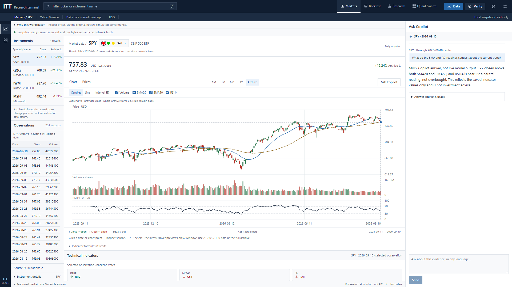
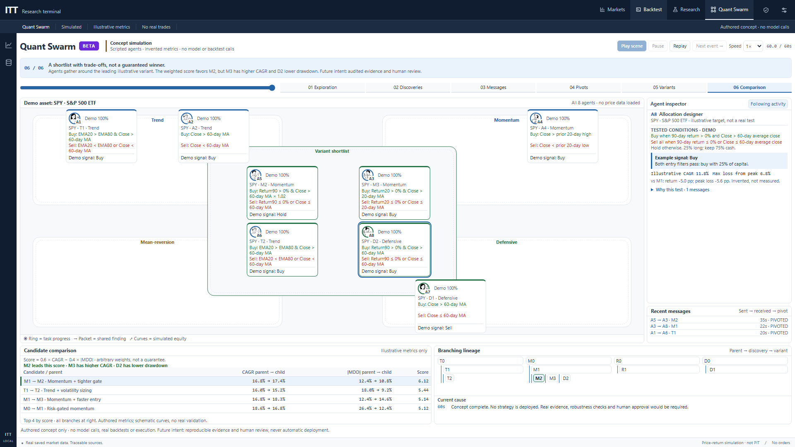
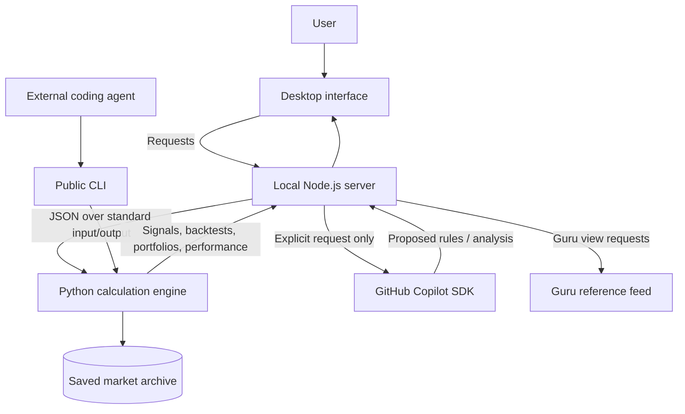

# Intelligent Investment Terminal

**A desktop research app for exploring market data and checking the numbers and sources behind a decision.**

View saved Yahoo Finance daily prices as charts and technical indicators, inspect the rules behind a signal, and use the public CLI to give external coding agents access to the same evidence.

**GitHub Copilot is the only current LLM integration.** Azure OpenAI and OpenAI integrations are outside the current scope.

The core workflow: **describe a strategy → generate rules → read the Buy / Sell / Hold summary → review rules & settings → run backtest.** Copilot proposes bounded rules, never executable code; Python generates signals and simulates them against saved prices. Nothing runs automatically and no orders are placed.

## What you can do

| Workspace | Current behavior |
|---|---|
| Markets | Download daily USD prices for 1–10 Yahoo symbols across an inclusive date range, then explore saved charts, indicators and signal explanations. Copilot chat uses only the selected asset's data through the selected date. |
| Backtest | Generate and review bounded rules for a single asset, fixed weights, or momentum allocation. Simulate next-open execution with fees, slippage, and session/monthly/quarterly rebalancing. Manual rule editing is also available. |
| Research | Compare return correlations or study outcomes after a condition. Event studies default to an independent manual condition; reusing reviewed Backtest entry rules and dates is optional. |
| Guru | Automatically retrieve easyinvesting's public reference feed. Table-first views cover funds, holdings, popular assets, and changes, with filing dates and provider limitations visible. Returns are provider estimates, not actual fund returns or independently SEC-verified performance. |
| Quant Swarm | Explore an eight-agent **Beta concept simulation** showing messages and strategy branches. Rules, signals and performance are scripted examples, not real model execution or backtests. |

Backtests stream progress with **CAGR** (annualized growth) and **MDD** (largest peak-to-trough loss), so return and risk can be inspected together. Charts can be hidden without hiding progress.

Chat appears only in Markets; other workspaces reclaim its space while preserving the conversation and draft. **Settings** is the sole connection/model setup entry and stays accessible throughout the app. Connection checking reads authentication and model metadata without running inference.

### Quant Swarm: shared discoveries, branching strategies

Quant Swarm demonstrates how specialists could collaborate on investment research, rather than simply running isolated tasks in parallel. Eight specialists explore trend, momentum, mean-reversion, and defensive approaches. Their findings travel between agents and influence what happens next: a momentum discovery can redirect a reversion specialist toward a different hypothesis, while another specialist adds defensive position sizing.

Shared discoveries produce distinct strategy branches. Parent links preserve where each variation originated, so an idea's evolution stays traceable. Candidates then come together in a shortlist that exposes return/drawdown trade-offs rather than declaring one winner.

The current implementation is an **interactive, scripted concept simulation** that demonstrates the intended collaboration model: explore → share → adapt → compare → human review.

## Get started

Launch the desktop app with `pnpm start` in a prepared environment; first-time setup is described in the developer guide. The app currently requires the source repository and a Python environment — no standalone installer is provided.

| Goal | Read next |
|---|---|
| Run the app and explore market data | [User guide](docs/01-user-guide.md) |
| Set up the development environment or change code | [Developer guide](docs/02-developer-guide.md) |
| Understand components and data flow | [Architecture](docs/03-architecture.md) |

Shared documentation and the app's static interface use English; user input and model responses may use other languages.

## Architecture

The desktop interface, a local Node.js server, and a Python calculation engine run on the user's computer. External coding agents reach the same Python services through the public CLI, so the desktop app and agents never produce different answers from the same saved data.

- **Desktop interface:** charts, strategy settings, portfolio analysis and results in one workspace.
- **Local server:** validates requests and routes them to the calculation engine; the same server backs both the desktop app and the agent-facing CLI.
- **Calculation engine:** applies reviewed rules to saved historical data and computes performance and risk; the single source of truth for results.
- **Saved market archive:** retains source and collection details for the data behind every analysis.
- **GitHub Copilot:** explains market information and proposes strategy rules only on explicit request; it does not run automatically or determine backtest results.
- **Guru reference feed:** a separate path for provider-reported institutional holdings; it does not enter backtests.

See [Architecture](docs/03-architecture.md) for the full breakdown.

## Proposed access and pricing

| Tier | Included capabilities | Proposed price |
|---|---|---|
| **Free** | Trend analysis and portfolio management, including static and dynamic allocation | **$0** |
| **Pro** | AI-driven chat and Quant Swarm | **Usage-based credits: 1 credit = US$1** |

These are proposed commercial terms, not implemented billing. Credits are intended to be consumed according to AI usage; one credit does not imply one chat request or one Swarm run, and per-task consumption remains unspecified.

## Intended benefits

The intended return is research productivity and better-informed decisions, not a promise of higher investment returns:

- **Less manual effort:** fewer repeated data transfers, tool switches, and strategy-setup steps.
- **Lower technical barriers:** explore quantitative ideas through natural-language proposals and readable rules.
- **More consistent collaboration:** people and external agents work from the same saved data and calculation services.
- **Earlier visibility into weaknesses:** examine costs, drawdowns, and benchmark comparisons before committing capital.
- **More reusable research:** explicit assumptions and exportable results support further inspection and comparison.

These are intended outcomes; time savings, cost reductions, and investment improvements have not been measured.

## Important limits

- Saved daily snapshots are not live prices, and requested dates do not guarantee complete coverage. Backtests simulate **price returns**, not dividend total returns, point-in-time-verified data, or survivorship-bias-free performance.
- Explicit Copilot analysis or rule-generation requests send the selected data and question, subject to organizational and service policies. Model output needs review; it is not investment advice or a return guarantee.
- Guru holdings dates and return coverage can differ. Public feed access does not establish redistribution rights or independent financial verification. Full reference-strategy parity and multi-currency research are not implemented.
- Browser tests do not establish native Electron or general model-quality acceptance; the intermittent Windows research-store failure remains unresolved. See the [scope and evidence history](docs/change-history/2026-09-11-future-scope.md) for dated checks and limitations.
