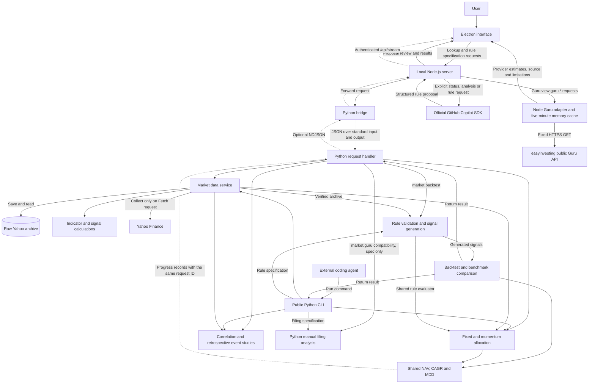

# Architecture

**Electron displays the interface, Node.js validates requests, and Python performs financial calculations on saved market data.** External coding agents use the same Python services through the public CLI. Automatic Guru retrieval follows a separate Node branch; its external reference data does not enter Python backtests.

Centralizing financial calculations prevents the interface and agents from producing different answers from the same data. The interface displays Python indicators, signals and performance. Display transformations, such as drawdown charts, use returned NAV rather than running a separate browser backtest.

The app provides saved Yahoo lookup, user-defined signals and backtests, allocation, statistics and automatic Guru reference retrieval. Recorded offline checks cover compact Guru layouts and Markets-only chat; a recorded full Node/UI regression also includes production Swarm integration. Saved-price/public-CLI parity and real Guru response display are earlier evidence. These records do not establish new Electron, real Copilot, external-feed, full Python regression or financial validation. See the [user guide](01-user-guide.md), [developer guide](02-developer-guide.md) and [change history](change-history/2026-09-11-future-scope.md) for operation, contracts and dated evidence respectively.

Shared documentation, the user-facing app, the [root README](../README.md) and video sources use English. Screen names match actual controls; arbitrary user input and provider responses are not forcibly translated.

## Runtime components

Electron hosts the web interface in a desktop window and manages the local HTTP server and Python process lifecycle. Node.js listens on loopback address `127.0.0.1`, accessible only from the user's computer. It exchanges JSON requests and responses with Python over standard input/output, using request IDs to correlate responses.

The shell stays within the viewport height; long workspace content scrolls internally. Chat appears **only in Markets**. Backtest, all Research tabs (Correlation, Event studies and Guru), and Swarm hide `copilot-panel`; `.chat-hidden` reclaims both the desktop sidebar and narrow-window bottom dock. The same DOM nodes, history and draft remain intact and reappear on return to Markets. Topbar **Settings** is the sole setup entry, independent of chat and accessible everywhere. Swarm's content and controls fit without scrolling at its target viewports; widths of 600px or less use a scrolling fallback. Browser verification does not count as native Electron verification.

The diagram shows connected lookup and calculation paths. Dashed edges represent optional progress streams, distinct from the single final response of ordinary RPC and CLI calls.

This is not a cloud-hosted server architecture. Yahoo collection, Copilot requests and Guru lookups communicate externally. Opening Guru triggers retrieval, but app startup does not silently collect data or schedule refreshes. Copilot status checks do not run inference; analysis and rule generation require explicit requests. On exit, Electron stops the server and Python processes it started.

### Code responsibilities

| Responsibility | Code |
|---|---|
| Desktop window and process lifecycle | [../ui/desktop.js](../ui/desktop.js), [../ui/desktop-policy.js](../ui/desktop-policy.js) |
| Asset/date selection, charts and details | [../ui/gui/app.js](../ui/gui/app.js), [../ui/gui/index.html](../ui/gui/index.html), [../ui/gui/style.css](../ui/gui/style.css) |
| HTTP validation and allowlisted dispatch | [../ui/gui-server.js](../ui/gui-server.js) |
| Node/Python request and response bridge | [../ui/backend.js](../ui/backend.js), [../src/itt/rpc.py](../src/itt/rpc.py) |
| Raw Yahoo storage, verification and daily-bar normalization | [../src/itt/market.py](../src/itt/market.py) |
| Technical indicators, default signals and their explanations | [../src/itt/indicators.py](../src/itt/indicators.py), [../src/itt/signals.py](../src/itt/signals.py) |
| User-rule validation and signal-driven Yahoo backtests | [../src/itt/criteria.py](../src/itt/criteria.py) |
| Fixed/momentum targets, fills and holdings | [../src/itt/portfolio.py](../src/itt/portfolio.py) |
| Shared interim/final NAV, CAGR and MDD definitions | [../src/itt/progress.py](../src/itt/progress.py) |
| Correlation and structured retrospective event returns | [../src/itt/analytics.py](../src/itt/analytics.py) |
| Holdings and changes from user-normalized filing JSON | [../src/itt/guru.py](../src/itt/guru.py) |
| Workspace routing, Research tabs, progress and event studies | [../ui/gui/research.js](../ui/gui/research.js) |
| Automatic Guru validation/cache and list/detail/change views | [../ui/guru-service.js](../ui/guru-service.js), [../ui/gui/guru.js](../ui/gui/guru.js) |
| Independent Quant Swarm's scripted scenes, messages and lineage | [../ui/gui/swarm.js](../ui/gui/swarm.js) |
| Shared declarative-rule limits for Copilot and the GUI | [../ui/criteria-schema.js](../ui/criteria-schema.js) |
| Public commands calling Python services | [../src/itt/cli.py](../src/itt/cli.py) |
| Copilot status, proposals, analysis and transmission scope | [../ui/copilot.js](../ui/copilot.js), [../ui/copilot-cli.js](../ui/copilot-cli.js) |

## Market data storage and lookup

An **archive** bundles one collection's raw responses and provenance. Its unique ID distinguishes data collected at different times.

### Downloading new data

For **Assets / Download market data**, Python retrieves Yahoo Finance daily prices, validates them and saves the original bytes unchanged. The GUI passes 1–10 unique uppercase symbols and start/end dates through HTTP and RPC to the collector. Both dates are inclusive: Yahoo receives `period1` at UTC midnight on the start date and `period2` at midnight after the end date. Daily (`1d`), USD-only restrictions remain. Unsupported requests are not replaced with other symbols.

Explicit requests use schema 0.2 `requested_bounds` to record dates, inclusivity and interval, alongside collection time, actual request URL, archive ID and raw hashes. Legacy calls without dates retain `range=1y` and schema 0.1. Reads reconstruct and validate expected metadata and URLs for both schemas; they do not migrate or overwrite old archives. Normalization excludes out-of-window bars using the recorded date basis before calculating existing indicators and signals. Raw responses and events remain unchanged.

A **hash** is a value computed from file contents. Comparing it on subsequent reads detects changes since storage.

A new archive becomes the latest only after every requested symbol is validated and saved. Partial collections are not published as the latest data. Existing archives are not deleted, assets are not automatically merged, and navigating tabs or choosing allocation examples does not collect prices. Actual first/last sessions and counts come from each asset's valid daily bars. The GUI separates the saved request window from actual coverage and labels first-to-last saved price change **Archive Δ**. It does not guarantee full requested coverage or identical coverage across assets; exact alignment checks still apply to calculations.

### Reading saved data

**Verify** and `market show` validate the latest archive's file list and hashes, then extract valid daily bars from the originals. Python calculates indicators and signals from those bars and returns the same format to the GUI and CLI.

Reads do not contact Yahoo. An unreadable archive causes failure, not substitution with another archive or invented prices.

## Aligning dates and calculated values

Providers can revise historical prices, so matching dates alone do not identify the same data. A bar is identified by **archive ID, symbol and observation timestamp**. GUI handoffs to external agents verify this identity and stop if the archive changes.

Bar, indicator and signal arrays share the same ordering. Values for a selected bar come from the same array index. Monetary and indicator values travel as strings to preserve decimal precision.

### Why display-range changes do not change values

Indicators are calculated over the full saved archive, using only each date's current and earlier data. The interface displays the selected slice of those results.

Switching from 1M to 3M therefore preserves values for the same date. The browser handles coordinates and formatting, not recalculation of moving averages or signals.

Insufficient history produces `null`, not zero or backend Neutral (displayed as Hold), and is never filled with an earlier value.

### Date and provenance limitations

Displayed dates use the exchange timezone. If it is unavailable, the app uses UTC and discloses the fallback.

Hashes do not prove price authenticity, historical information availability, the complete historical asset universe or redistribution rights.

## Default technical signals

The default signal follows Python's `technical-vote-v1`: a summary of three technical comparisons, not an AI answer or the user's entry/exit criteria.

**SMA** averages closing prices over a fixed period to describe trend. **MACD** is the difference between short- and long-period exponential moving averages, compared with its smoothed signal line. **RSI14** measures price-movement strength from gains and losses.

The following table uses **backend labels**. `Neutral` remains part of `technical-vote-v1`, including count keys; the UI displays it as yellow **Hold** in signal labels, vote counts, rule text and the three existing per-indicator colored vote markers. An individual Hold means no directional vote, not an executed hold, position instruction or order. This presentation alias does not change the backend voting rules or user-defined Backtest signals.

| Indicator | Buy | Sell | Neutral |
|---|---|---|---|
| Moving averages | SMA20 > SMA50 | SMA20 < SMA50 | Equal values |
| MACD | MACD > its nine-period signal line | MACD < its nine-period signal line | Equal values |
| RSI14 | Above 55 | Below 45 | 45–55 inclusive |

Two or more Buy votes produce Buy; two or more Sell votes produce Sell; otherwise the backend result is Neutral, displayed as Hold because neither direction reaches two votes. Any missing required value produces Unavailable, not Hold. Responses include the individual values, conditions and explanations for inspection.

The technical table's 13 **Reading** rows and categorical icons interpret trend, momentum, volatility and related indicators for display. They are not 13 Buy/Sell votes; the asset signal aggregates only the three Python votes above.

Profitability is unverified. This rule is neither investment advice nor an order, and it does not replace user-defined signals.

## User criteria and backtests

**Backtest** is a standalone top-level workspace, not a Markets tab. Single asset, Static allocation and Dynamic allocation share the rules form, review, execution and results area. The flow is description → **Generate rules** → readable **Buy / Sell / Hold** summary → **Review rules & settings** → **Run backtest**. Backtest has no chat; Markets chat is not connected to rule generation or execution.

`activeRules()` binds a natural-language proposal to its description, archive, symbol and observation timestamp. Changes to the description or source invalidate the proposal and review; stale responses are discarded. Settings changes also require another review. **Build rules manually** is an explicit secondary path. Active advanced JSON disables simple inputs to prevent overwriting compound rules.

`runBacktest()` sends reviewed single-asset criteria to `market.backtest` and allocation specifications to `market.portfolio`. Requests with progress use the optional HTTP stream below. Python validates the specification, generates entry/exit signals for each date and backtests **those signals**. The GUI and public CLI share the evaluator and simulator. Results include signal explanations, NAV, drawdown, performance, fills and allocation records.

Calculation rules:

- Fix the saved Yahoo archive, symbol or allocation assets, and exact starting/ending sessions. Multiple assets must have identical dates, timestamps, timezone and date basis. No intersection or missing-date fill is applied.
- Specify initial cash, fees and slippage. Costs use basis points: 1bp = 0.01%. Close-time signals execute at the next observed open, with integer units, long-only positions, no borrowing and unused cash retained.
- Strategy and buy-and-hold benchmark share the same period and costs. Warmup `null` values do not become signals; final-session signals do not execute outside the window. Missing required prices are not replaced with invented fills.
- Public entry points are `market backtest --spec PATH [--store PATH]`, `market portfolio --spec PATH [--store PATH]` and their schema queries. Results are returned, not written to the synthetic research store.

Entry and exit rules can nest `all`, `any` and `not`. Comparisons include `gt`, `lt`, `gte`, `lte`, `eq` and upward/downward crossings. Operands support OHLC, existing indicators, custom-period SMA/EMA/RSI/ROC/return/volatility, lagged OHLCV and arithmetic. Periods span 1–252 observations and lags 0–252. A declarative **AST** (abstract syntax tree) represents rules as data, not executable source. Each rule is bounded to depth 12, 128 nodes, 32 children and cost 4096. Indicator cost scales with period; crossing operands count twice. Arbitrary code, function calls and property access are unavailable. Any unavailable descendant makes the entire compound rule unavailable; `any` and `not` cannot bypass this.

### Allocation and accounting

Fixed allocation updates asset eligibility daily but trades only on its rebalancing schedule. Ineligible weights remain cash; unavailable assets retain their quantities. Momentum equally distributes the original total weight across the top N eligible assets whose trailing close returns exceed `max(0,minimum_return)`. Ties resolve alphabetically. Unavailable or unselected assets target zero; no winners means cash. An asset with zero original weight remains a momentum candidate if present in the specification.

Schedules use observed sessions, months or quarters with interval N. Monthly N=1 decides at the close of the window's first session and the first observed session of each subsequent observed month, then fills at the next observed open. It is **not month-end execution**. The GUI sends N=1 for months/quarters; CLI/API support explicit N. Month/quarter intervals count observed periods, and no new order is created on the final session. This does not reproduce the BAA strategy family or optimize weights.

Integer targets are fixed from close-time NAV. At the next open, sells precede alphabetical buys, subject to cash limits; unfilled remainders expire. Strategy and benchmark use the same fee/slippage accounting. Progress display does not deduct fees again or introduce a separate browser return calculation.

### Interim metrics and optional streams

`metrics_snapshot()` returns interim and final metrics from the same ledger. **NAV** (net asset value) is cash plus holdings valued at the close. **MDD** (maximum drawdown) is the running maximum decline from a peak, including initial cash as a peak. **CAGR** (compound annual growth rate) annualizes growth as `(nav/initial_cash)^(365.25/elapsed_calendar_days)-1`; zero elapsed days on the start date and overflow yield `null`. See the [developer guide](02-developer-guide.md) for numeric definitions.

Only explicit `market.backtest.stream` and `market.portfolio.stream` RPC requests emit `{id,event:'progress',data}`. `data` contains the strategy/benchmark phase, completed/total counts, observation date, NAV, CAGR and MDD. Progress and the ordinary final `{id,ok,result}` or error response share one request ID. Node neither treats progress as a final result nor routes it to another request. Ordinary `market.backtest`/`market.portfolio` RPC and CLI calls retain one result only.

HTTP `POST /api/stream` uses the same Host, Origin and session-token (`X-ITT-Token`) checks as `/api`. Clients send the ordinary `market.backtest` or `market.portfolio` name and `{spec}`; the server chooses RPC `.stream` and supplies the store path. HTTP emits `{event:'progress',data}` followed by `{event:'result',result}` or `{event:'error',error}`. The [developer guide](02-developer-guide.md) details the transport contract.

The browser displays actual processing checkpoints. **Hide progress charts** leaves the progress bar visible; **Show progress charts** restores charts. Timers do not invent percentages, remaining time or performance. Hiding charts neither cancels calculations nor enables concurrent execution. Errors or disconnection before the final result are not success. Recorded browser checks matched actual streams and entire public CLI results; Electron evidence predates the redesign.

These results simulate price returns from the current saved archive. **PIT** (point-in-time) means using only information actually available at a historical decision time. Yahoo collection timestamps do not establish past publication times. Without a historical universe including delisted assets, results are not claimed to be survivorship-bias-free. They are not dividend-reinvested total returns either.

Natural-language criteria follow `generateCriteria()` → `copilot.criteria` → official SDK. Validated compound proposals remain intact in advanced JSON; users set weights, cadence and period. Python runs only after user review and execution. Keywords or regular expressions do not imitate natural-language understanding. Historical evidence covers a real `gpt-5.4-mini` Korean SMA17/RSI9 case with AND entry, OR exit and whole-result CLI parity. The model proposes rules; it does not calculate signals or performance.

## Separate statistics, filings and concept demos

### Correlation and independent Event studies

`market.correlation` and `market.trigger` RPC accept `{store_path,spec}` and verify the archive. Correlation compares simple returns between consecutive sampled closes: daily closes, or the last observed close of each ISO week/calendar month within the window. Partial boundary periods are included; no pre-window base price or out-of-window period-end price is used. Insufficient samples or zero variance produce `null` with a reason.

Event studies observe returns from the next observed open to the h-th forward session close after **every** date whose close-based condition is true. Horizons are unique integers from 1–60 and outcomes remain within the end date. Conditions use only current and past data; future prices are used solely for the explicitly retrospective outcome. Incomplete outcomes are `null`; summary statistics use complete outcomes only. Overlapping windows are not independent samples.

**Research / Event studies defaults to Independent condition**, a manual workflow with its own condition asset, comparison and saved-session dates. Its initial example is RSI14 < 30. It requires saved data and valid inputs, **not a Backtest review**. The condition asset initializes its saved-session window; changing the return target does not shift dates. Both assets must contain the selected endpoints, with exact backend alignment still required.

**Reviewed Backtest entry and dates** is optional. Only that mode requires a valid Backtest review and reuses `activeRules().entry`, the current selected symbol and reviewed dates; manual condition/source/date controls are disabled. In either mode, users choose the return target and `horizons`. Exit rules, fees, slippage and execution models do not apply. This is retrospective statistics, not a tradable backtest, evidence of causation or an independent natural-language event-specification generator. Historical records describing mandatory Backtest reuse apply only to the earlier UI.

### Automatic Guru reference retrieval

Authenticated local `/api` methods `guru.funds`, `guru.quarters`, `guru.fund`, `guru.popular` and `guru.changes` route to the Node adapter. The remote origin is fixed to `https://easyinvesting.app/api/guru/*`; only listed CIKs, quarters and allowlisted filters are accepted. Defaults are a 15-second timeout, 8MiB response limit, rejected redirects/credential forwarding, shape validation and a five-minute memory cache. Cache limits are 64 entries/32MiB, concurrency is capped at eight requests, and in-flight requests for the same URL are shared. Errors, expiry and failed refreshes are not hidden by stale cache or invented data; there is no automatic retry. The renderer requests through the server only, without uploading data or passing it to Python.

Overview, detail, popular holdings/buys/sells, changes, filters and filing status display provider data. An earlier independent public GET check observed 79 default funds with both `active` and `show_in_default` true out of 87 total. Network-response verification is not financial-calculation verification. Returns, weights and percentage changes are already percentage points. Holdings quarter and performance start/end dates are separate; historical holdings responses can include later performance and are not PIT backtests. Estimates are not actual fund returns, SEC authentication or ITT's independent performance calculations. Public API access is not a redistribution license. URLs, fetch time, cache age, provider notes and missing values remain visible or inspectable.

Guru keeps titles, tabs, filters and Overview summaries/counts compact. A short estimate/delayed-13F warning stays visible; full notes and limitations remain expandable. Detail renders holdings before filing summaries and secondary estimated-performance/weight charts. This changes information order, not provider calculations or data contracts.

### Manual Python Guru compatibility

Python `market.guru` RPC accepts **`{spec}` only**. It analyzes user-normalized filing JSON without a Yahoo store path. `filed_at <= as_of` filters date-level availability, then compares each manager's latest and previous supplied periods. Duplicate manager/period pairs and CUSIPs are rejected; amendments are not automatically selected. SEC URL syntax checks neither retrieve nor authenticate filings. The app discloses 13F delays and partial holdings coverage; it does not infer actual trades or full-fund returns. `schema guru` and `market guru --spec PATH` remain available. Earlier manual UI/CLI fixture parity does not verify today's automatic interface or real SEC filings.

### Scripted Quant Swarm

Top-level **Quant Swarm · Beta** is a full-viewport **concept simulation** in an [independent module](../ui/gui/swarm.js). Its authored scenario retains 60 seconds, eight agents, six chapters, four message-driven pivots and twelve candidates. A purple Beta background surrounds header controls, current phase, the eight-agent arena, auto-follow inspector, latest three messages and top-four candidate table. Lineage shows all twelve nodes and the cause of the current change. The [eight Koboyo people SVGs and their license/provenance](../ui/gui/avatars/README.md) are fixed local assets, not an icon library or picker; runtime icon requests are absent.

The demo explicitly names **SPY · S&P 500 ETF**, but loads no price data. Buy/Sell conditions, sample observations and Buy/Sell/Hold outcomes are **scripted examples**, not evaluated rules. Examples include an EMA20/EMA80 crossover, Close > SMA60, RSI14 crossing above 30, and a 90-day return gate. Candidate variants illustrate trend filters, cash exposure and risk gates. Neither sample signals nor invented CAGR/MDD values are calculated from those rule cards or a saved SPY archive.

`stateAt()` reproduces scene state; the frame clock controls playback only, which pauses when leaving the workspace. All performance, curves and scores are fictional, with no API, model or backtest calls. [Historical production-browser verification](change-history/2026-09-11-future-scope.md) checked layout and controls at 1366×768, 1440×900, 1920×1080 and 800×1000. Production Swarm integration also passed in the recorded full Node/UI suite. Those records do not newly validate financial calculations, the entire Python suite, native Electron or later rule-card changes. Real research progress remains separate from demo animation.

## GitHub Copilot

Connection checks and model selection exist only inside topbar **Settings**. Opening it makes no request; Escape returns focus to its topbar button. The account-details toggle reveals the current SDK account, not account selection/switching, and makes no external request. **Check connection** retrieves authentication metadata and the authenticated account's model list without inference or price transmission. Account display is limited to login, host and authentication type; tokens and raw errors are not exposed.

Desktop and default services use `authOnly: false` and do not require an Enterprise account. Choosing a model and explicitly requesting analysis or rules authorizes that transmission without a separate mandatory consent checkbox. Validation permits omitted `consent` but rejects explicit `false`.

The service rereads the default archive and checks archive/symbol/timestamp identity. It constructs only the selected symbol's bars from archive start through the selected timestamp, aligned indicators and definitions, limited provenance and the question. Other assets, future bars, notes, local paths and previous answers are excluded. The visible chart range does not define transmission scope. Backtest results, correlation, events, Guru and Swarm context are also excluded, which is why chat appears only in Markets. Preserving chat history does not expand the transmitted context.

The SDK has no file, shell, MCP, search, research-execution or order tools, and model calls are not automatically retried. Provider answers are unverified text. Raw/context hashes identify inputs; they do not prove answer or citation accuracy. Usage totals include only provider-reported values; missing token counts or costs remain unknown, not zero.

Real-model evidence consists of two pre-redesign calls on the same single Korean condition example. Offline revalidation corrected the original verifier's undocumented `supported:true` requirement and compared existing evidence without new model or GUI execution. Later browser integration passed separately, without new SDK model calls. This does not establish general multilingual generation, analysis quality or user acceptance. Mock-SDK boundary checks remain distinct from real-model evidence. Organization policies and the user's requested transmission scope still apply.

### Renderer restrictions

The renderer cannot directly access Node.js, files or the shell. Electron isolates it and blocks external navigation, new windows, permission requests and automatic downloads. Result export is a narrow exception: a user-initiated same-origin JSON blob from the current app-owned page, with known size greater than zero and at most 8MiB, an allowed result filename, JSON MIME and a single URL. Export uses the native save dialog without granting renderer file access. Metadata checks do not authenticate JSON contents; see the [developer guide](02-developer-guide.md) for limits and the actual Electron verification scope.

The local server checks request host, origin and session token, then passes only allowlisted methods and arguments. Criteria backtests do not permit arbitrary file or shell access. Lookup authorization does not authorize unrelated installation, collection, storage, external transmission or deployment. These controls do not constitute a comprehensive security audit.

## Separate synthetic research engine

The development research engine uses artificially generated data to test trading and accounting. Synthetic results are never presented as actual investment performance.

[../src/itt/contracts.py](../src/itt/contracts.py) and [../src/itt/data.py](../src/itt/data.py) validate inputs. [../src/itt/engine.py](../src/itt/engine.py) handles close-time decisions, next-open fills, costs, dividends, splits and delisting settlement. [../src/itt/store.py](../src/itt/store.py) preserves inputs, specifications and results and compares reruns of identical inputs.

Raw Yahoo data and synthetic research results use different stores and input formats. Synthetic corporate-action and PIT input checks do not prove Yahoo history is complete. Public CLI and test dependencies still use the synthetic engine, contracts, store and research jobs; being outside the main desktop path is not a reason to delete them.

Storage failures remain failures and existing data is preserved. Intermittent `unable to save run` failures recurred in the unchanged Windows storage path; subsequent passing tests do not establish a fix. Access denial during rename was observed, but its cause and remedy remain unconfirmed. Current Yahoo criteria backtests do not use research-bundle persistence or replay.

## Design references

Design references include OpenBB's separation of acquisition and normalization, Qlib's time-aware data processing and Ghostfolio's separation of calculation code.

easyinvesting's correlation, static allocation, dynamic allocation, Vibe and Guru routes, plus the [agent_quant_stock research workflow](https://github.com/kimtth/agent-quant-stock-invest/tree/main/agent_framework), are functional references. The latter's data → generated-code REPL → signal validation → backtest workflow informs the process, but this app executes no generated code: it evaluates bounded declarative ASTs only. Automatic Guru retrieval is implemented; multi-currency support, long histories, 30 assets, the full named-strategy catalog, independent fund-performance calculations and usage rights are not all complete. The [scope history](change-history/2026-09-11-future-scope.md) records those differences. Video production remains deferred, existing media is preserved and English sources have not been newly rendered.

Design inspiration is not code reuse. Reuse or distribution requires checking each project's license and notice obligations. [AlphaSense reference material](../ref-app/AlphaSense/README.md) records the interface-image provenance.